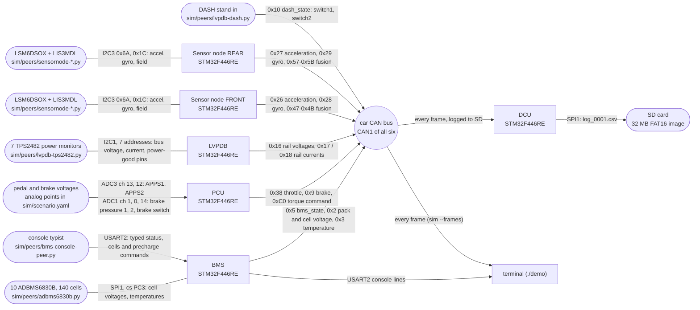
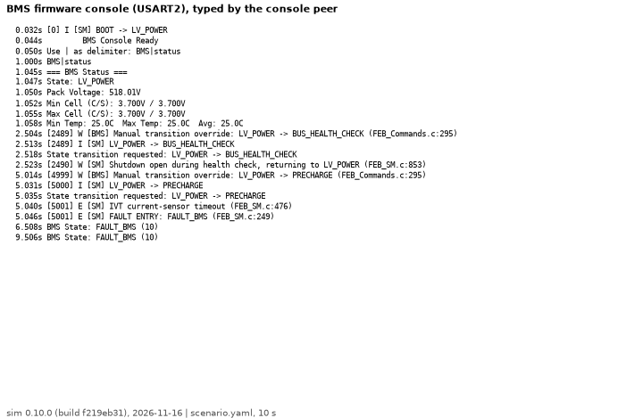
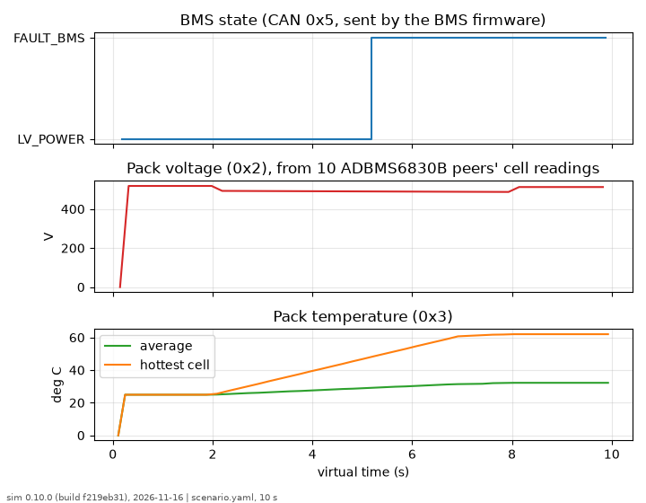
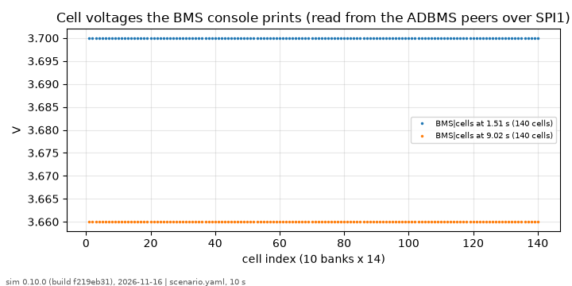
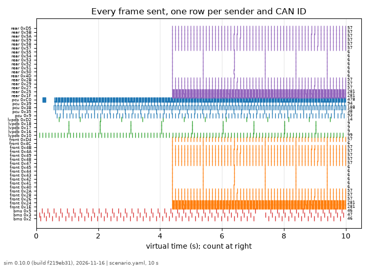
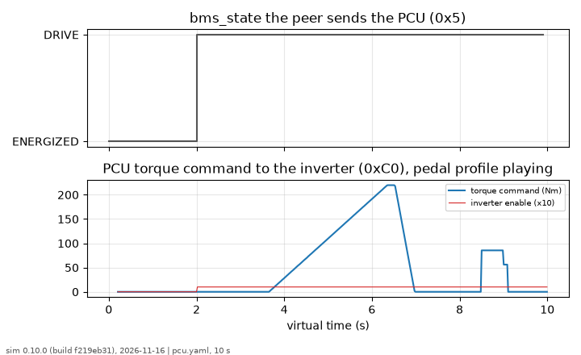

## Demo: the six-board SN5 car in simulation

```sh
./demo          # after ./demo build (once)
```




The six STM32F446RE images (BMS, PCU, DCU, LVPDB, Sensor_Nodes FRONT and REAR) are the team's firmware, built
unmodified, and they boot and talk on one simulated CAN bus (`sim/scenario.yaml`, 6.5 virtual seconds). `./demo`
prints two kinds of line: values decoded from CAN frames a board sent (layouts from
`common/FEB_CAN_Library_SN4/gen/FEB_CAN.dbc`), and lines the firmware printed on its own console. What it shows: the BMS
reads 140 cells from the ADBMS chain, a typed console command asks for PRECHARGE, the firmware faults on
`IVT current-sensor timeout` (there is no current-sensor peer), and the PCU keeps its torque command at 0.0 Nm with the
inverter disabled while the throttle goes to 100 %, because the BMS never reaches DRIVE.

**Synthetic:** everything off the six MCUs is a Python peer or a scripted input at the transaction level (CAN frames,
SPI/I2C bytes, ADC pin voltages), not an electrical model. The cell voltages, pack sag and cell temperatures come from
the ADBMS peer's invented load profile; the rail currents from the TPS2482 peer's invented loads; the acceleration from
the IMU peer's invented profile; the pedal and brake voltages are scripted points; the DASH is a stand-in that only
sends `dash_state`; the BMS console commands are typed by a peer. Each board's CAN2 has a passive node so the controller
can start (not drawn). There is no inverter, IVT current sensor, GPS, LoRa radio or shutdown-loop wiring. Nothing here
is measured against the real car.

Prerequisites: Simantic's `sim` 0.10.1 (`curl -fsSL https://simantic.com/install | sh`; proprietary, not open source),
`mtools` for the DCU's SD image, plus `arm-none-eabi-gcc`, `cmake` and `ninja` for `./demo build` (it runs
`sim/build.sh`: submodules, then the repo's own Debug preset). The run took 2.5 to 5 minutes of wall clock on a heavily
loaded laptop; the GIF is sped up 16x.

## This fork: the car in a simulator

This is Simantic's fork of Formula Electric at Berkeley's SN5 firmware, kept as a simulation showcase. It runs the
team's firmware, **unmodified**, for six STM32F446RE boards on one simulated CAN bus: no boards, no bench.
The work is on the `sim-demo` branch (upstream's default branch is a later `vehicle/sn6` line; this branch is
based on upstream `main`, commit `0b7bffe`, the SN5 firmware).

**Please read first.** The upstream repository has no licence file (GitHub reports none), so nothing in this fork is a
licence grant, to the firmware or to the `sim/` directory. The fork adds nothing to the firmware: only `sim/`
and this section. It is not connected to upstream for pushes, and nothing here is offered back or posted upstream.
If you are on the team and want this removed, say so and it goes.

```
BMS console (USART2, typed by a peer), BMS firmware's own lines
  0.032 s  BOOT -> LV_POWER
  1.050 s  Pack Voltage: 518.01V            (10 ADBMS6830B peers, 140 cells at 3.700 V)
  2.504 s  Manual transition override: LV_POWER -> BUS_HEALTH_CHECK
  2.523 s  Shutdown open during health check, returning to LV_POWER
  5.014 s  Manual transition override: LV_POWER -> PRECHARGE
  5.040 s  E [SM] IVT current-sensor timeout
  5.046 s  E [SM] FAULT ENTRY: FAULT_BMS
```



The BMS firmware's console output from `sim/run.sh` (scenario.yaml, 10 virtual seconds, Simantic `sim` 0.10.0
build f219eb31, 2026-11-16). Console lines are typed by `sim/peers/bms-console-peer.py`.



The BMS's own CAN frames 0x5, 0x2 and 0x3 from the same run, against virtual time. The 2.5 s step to
BUS_HEALTH_CHECK and back is shorter than the 100 ms frame period and does not show here; the console lines above do.
The pack voltage and temperature curves come from the ADBMS peer's load profile (a stand-in, below).



The 140 cell voltages the BMS console prints at 1.51 s and 9.02 s (`BMS|cells`), read by the firmware from the ADBMS peers
over SPI1. The peer sags every cell equally, so each dump is a flat line. Same run and build.



Every frame sent in the six-board run (3404 in 10 s), one row per sender and CAN ID, count at the right. The
rows labelled LVPDB 0x10 are the DASH stand-in peer, which shares the LVPDB machine's tag. Same run and build.



`sim/pcu.yaml` (PCU alone, 10 virtual seconds, same build and date): the PCU's torque command (CAN 0xC0), decoded, while
the analog pedal profile plays and a peer sends BMS state ENERGIZED, then DRIVE at 2 s. Peak 219.8 Nm at 6.37 s. At
9.1 s the firmware itself logs `APPS implausibility latched` and cuts torque.

**What runs** (`sim/scenario.yaml`, one bus per CAN controller):

| Board | Firmware | In the simulation |
| --- | --- | --- |
| BMS | `BMS` | boots, state machine, console, 10 ADBMS6830B on SPI1, bms_state/voltage/temperature frames |
| PCU | `PCU` | boots through 8/8 setup steps, ADC pedal and brake inputs, RMS/BMS CAN, torque commands |
| DCU | `DCU` | boots, console, SD card on SPI1, logs every CAN frame it hears to `log_0001.csv` |
| LVPDB | `LVPDB` | boots, finds 7/7 TPS2482 on I2C1, power-good lines |
| Sensor_Nodes FRONT, REAR | `Sensor_Nodes_FRONT/REAR` | boot, IMU and magnetometer on I2C3, gyro calibration, IMU/fusion/WSS frames |
| DCU_Receiver, UART | | boot and print their consoles (alone: nothing to talk to) |

**The scenario**, as `sim graph --scenario sim/scenario.yaml` prints it (square boxes are the MCUs running the firmware,
rounded boxes are the modelled parts, hexagons are buses):

```mermaid
flowchart LR
  bms["bms<br/>STM32F446RE"]
  bms_spi1mux(["spi1mux<br/>SPI.SPIMultiplexer"])
  bms -- "spi1" --- bms_spi1mux
  bms_adbms(["adbms<br/>SPI.ScriptedSpiSlave"])
  bms -- "spi1mux 0x0" --- bms_adbms
  bms_consolepeer(["consolepeer<br/>UART.ScriptedUartPeer"])
  pcu["pcu<br/>STM32F446RE"]
  pcu_rms(["rms<br/>CAN.ScriptedCanNode"])
  dcu["dcu<br/>STM32F446RE"]
  dcu_sdcard(["sdcard<br/>SPI.SDCard"])
  dcu -- "spi1 0x0" --- dcu_sdcard
  dcu_can2peer(["can2peer<br/>CAN.ScriptedCanNode"])
  lvpdb["lvpdb<br/>STM32F446RE"]
  lvpdb_lv_tps(["lv_tps<br/>I2C.ScriptedI2cSlave"])
  lvpdb -- "i2c1 0x4b" --- lvpdb_lv_tps
  lvpdb_sh_tps(["sh_tps<br/>I2C.ScriptedI2cSlave"])
  lvpdb -- "i2c1 0x4a" --- lvpdb_sh_tps
  lvpdb_lt_tps(["lt_tps<br/>I2C.ScriptedI2cSlave"])
  lvpdb -- "i2c1 0x40" --- lvpdb_lt_tps
  lvpdb_bml_tps(["bml_tps<br/>I2C.ScriptedI2cSlave"])
  lvpdb -- "i2c1 0x4f" --- lvpdb_bml_tps
  lvpdb_sm_tps(["sm_tps<br/>I2C.ScriptedI2cSlave"])
  lvpdb -- "i2c1 0x42" --- lvpdb_sm_tps
  lvpdb_af_tps(["af_tps<br/>I2C.ScriptedI2cSlave"])
  lvpdb -- "i2c1 0x41" --- lvpdb_af_tps
  lvpdb_cprf_tps(["cprf_tps<br/>I2C.ScriptedI2cSlave"])
  lvpdb -- "i2c1 0x47" --- lvpdb_cprf_tps
  lvpdb_dash(["dash<br/>CAN.ScriptedCanNode"])
  front["front<br/>STM32F446RE"]
  front_can2peer(["can2peer<br/>CAN.ScriptedCanNode"])
  front_imu(["imu<br/>I2C.ScriptedI2cSlave"])
  front -- "i2c3 0x6a" --- front_imu
  front_mag(["mag<br/>I2C.ScriptedI2cSlave"])
  front -- "i2c3 0x1c" --- front_mag
  rear["rear<br/>STM32F446RE"]
  rear_can2peer(["can2peer<br/>CAN.ScriptedCanNode"])
  rear_imu(["imu<br/>I2C.ScriptedI2cSlave"])
  rear -- "i2c3 0x6a" --- rear_imu
  rear_mag(["mag<br/>I2C.ScriptedI2cSlave"])
  rear -- "i2c3 0x1c" --- rear_mag
  medium0{{"can"}}
  bms -- "can1" --- medium0
  pcu -- "can1" --- medium0
  dcu -- "can1" --- medium0
  lvpdb -- "can1" --- medium0
  front -- "can1" --- medium0
  rear -- "can1" --- medium0
  lvpdb_dash --- medium0
  medium1{{"can"}}
  pcu -- "can2" --- medium1
  pcu_rms --- medium1
  medium2{{"can"}}
  dcu -- "can2" --- medium2
  dcu_can2peer --- medium2
  medium3{{"can"}}
  front -- "can2" --- medium3
  front_can2peer --- medium3
  medium4{{"can"}}
  rear -- "can2" --- medium4
  rear_can2peer --- medium4
  medium5{{"uart"}}
  bms -- "usart2" --- medium5
  bms_consolepeer --- medium5
```



**Configurations tried** (all `sim` 0.10.0 build f219eb31, 2026-11-16, Debug build, Arm GNU toolchain `arm-none-eabi-gcc`, firmware `0b7bffe`):

| Configuration | Virtual | Wall | Result |
| --- | --- | --- | --- |
| `sim/scenario.yaml`: BMS, PCU, DCU, LVPDB, FRONT, REAR on one CAN1 bus | 10 s | about 2 min on a loaded laptop | runs. 17 assertions in `sim/run.sh` pass: 3404 frames sent, BMS state seen by PCU and DCU, DCU wrote 3378 rows to its SD log |
| `sim/bms.yaml` | 10 s | 25 s | runs: 139 frames sent, BMS goes LV_POWER, BUS_HEALTH_CHECK, back, PRECHARGE, FAULT_BMS at 5.05 s |
| `sim/pcu.yaml` | 10 s | 25 s | runs: torque command peaks at 219.8 Nm, APPS implausibility at 9.1 s |
| `sim/front.yaml`, `sim/rear.yaml` | 8 s | 11 s, 13 s | run: 723 frames sent by each node |
| `sim/lvpdb.yaml` | 10 s | 21 s | runs: 7/7 TPS2482, 140 frames sent |
| `sim/dcu.yaml` | 10 s | 7 s | runs: SD mounts and logs; RFM95 radio fails 5/5 init attempts (no radio peer) |
| `sim/dcu-receiver.yaml`, `sim/uart.yaml` | 3 s | 1 s | boot and print consoles; nothing to talk to |
| `sim/dart.yaml` (DART, STM32F042K6) | 3 s | 3 s | boots to the main loop (symbol trace), but prints nothing: see gaps |
| DASH (STM32F469), UART_TEST (STM32U575) | | | `unverified`: neither MCU is in `sim models` for 0.10.0, not run |

**The peers** in `sim/peers/` are Python models following the firmware's own drivers and the team's CAN definitions
(`common/FEB_CAN_Library_SN4/gen/FEB_CAN.dbc`):
- `adbms6830b.py`: the ten-IC ADBMS6830B chain (framing and PEC from the firmware's own driver). Its rest/load/hot-cell
  profile is a **stand-in**: invented, time-compressed, marked `MODELED SIMPLIFICATION` in the file.
- `lvpdb-tps2482.py`: the seven TPS2482 monitors (register behaviour from the datasheet; load profile invented).
- `lvpdb-dash.py`: DASH stand-in, sends dash_state 0x10 every 100 ms; the driver's switches at 1.0 s are invented.
- `sensornode-lsm6dsox.py`, `sensornode-lis3mdl.py`: IMU and magnetometer on a car-like profile (invented).
- `pcu-can-peer.py` + `pcu-sn5-drive.py`: the PCU's pedal/brake profile (analog points in `pcu.yaml` are generated by
  `pcu-gen-points.py`) and the BMS state it hears; `dcu-can-peer.py`: replays other boards' traffic for the DCU alone.
- `bms-console-peer.py`, `bms-can-observer.py`, `sensornode-canpeer.py`: console typist and passive CAN nodes.

**Gaps, with the evidence:**
- **Every F446 board needs both CAN1 and CAN2 on a bus.** **Corrected 2026-11-16:** an earlier version of this page said
  FRONT with CAN2 unwired called `FEB_CAN_TX_Send` 580,258 times in 4.6 s with zero frames on the wire. That figure does not
  reproduce; the investigation measured 56 `FEB_CAN_TX_Send` calls in 4.6 s (sim 0.10.0, `Sensor_Nodes_FRONT`; not re-run
  for this edit). What happens with CAN2 unwired: `HAL_CAN_Start(hcan2)` times out (CAN2 MSR `0x40006804` polled 27,326
  times at the INAK wait loop, pc `0x0800b66a`); `FEB_CAN_Init` then calls `HAL_CAN_Stop(hcan1)` and `FEB_CAN_DeInit()` and
  returns an error, which `FEB_Main.c:199` ignores; every later `FEB_CAN_TX_Send` returns NOT_INIT, so `feb_can_tx_enqueue`
  and `HAL_CAN_AddTxMessage` get 0 hits and nothing reaches the bus. With CAN1 and CAN2 both wired: 132 `FEB_CAN_TX_Send`,
  132 enqueue, 132 `HAL_CAN_AddTxMessage`, and FRONT sends 0x26 and friends. Firmware observation: the return value of
  `FEB_CAN_Init` is ignored, and a CAN2 failure de-inits CAN1. The simulator's INAK wait on a floating CAN2 RX is deliberate
  (RM0390: the peripheral waits for 11 recessive bits; the model cites a NUCLEO-F446RE rev A measurement). The simulator gap
  is that a scenario cannot declare "transceiver fitted, bus empty" (a one-endpoint medium is rejected), so each scenario
  gives CAN2 a passive node. `unverified`: whether the FEB board has a CAN2 transceiver. The DCU alone with CAN2 unwired
  printed nothing at all; with CAN2 wired it boots.
- **No RFM95 (LoRa) peer.** DCU logs `Chip version mismatch: 0x00 (expected 0x12)` 5 times then `FATAL: Init failed`; the
  DCU-to-DCU_Receiver telemetry link is not exercised.
- **BMS cannot leave LV_POWER on its own.** With the shutdown loop open the health check backs out (2.52 s), and
  PRECHARGE faults on `IVT current-sensor timeout` at 5.04 s: there is no IVT current-sensor peer and no shutdown-loop pin
  wiring, so ENERGIZED and DRIVE are not reached by the real BMS. The PCU scenario takes its DRIVE state from a peer.
- **No TPS2482 on the BMS and PCU I2C1** (`CONFIG write failed for BMS @ 0x40`, repeated by the PCU every 250 ms).
- **No GPS on FRONT and REAR UART4** (`No NMEA at either baud; module may be absent`).
- **DART (F042K6): no console output.** The firmware reaches `FEB_Main_Loop` and calls `HAL_UART_Transmit_DMA` for 72 bytes at
  1.76 ms; nothing appears on USART2 in 3 s. Cause not established.
- The simulator warns that the boards enable HSE but declare no crystal and assumes 8 MHz; the `.ioc` files say 8 MHz.
- Not run: DCU_Receiver with a radio, DASH, UART_TEST, a CAN2 bus shared between boards.

**Run it** (needs CMake, the Arm GNU toolchain, Simantic's `sim` on PATH, and `mtools` for the DCU's SD image):

```
sim/build.sh              # all eleven images into build/Debug (the repo's own preset)
sim/run.sh                # scenario.yaml, 10 virtual seconds; asserts on the firmware's own output
sim/run.sh pcu.yaml 10    # any single-board configuration; logs and frames in sim/out/<name>/
python3 sim/plot.py       # redraws sim/screenshots from the last runs (needs matplotlib)
```

**Changes to the firmware: none.**

Everything below is the Formula Electric at Berkeley team's README.

---

# FEB Firmware SN5

Firmware for the FEB SN5 Formula E vehicle. Each subdirectory corresponds to a board on the car, built around STM32F4 microcontrollers.

## Project Structure

| Directory | Board | MCU | Notes | Docs |
|-----------|-------|-----|-------|------|
| `BMS/` | Battery Management System | STM32F446RE | FreeRTOS, cell-monitor front-end | [BMS/README.md](BMS/README.md) |
| `DART/` | Fan / Tachometer Controller | STM32F042K6Tx | Cortex-M0, bare-metal, `-Os` | [DART/README.md](DART/README.md) |
| `DASH/` | Driver Dashboard | STM32F469NI | FreeRTOS, LVGL, SDRAM, FATFS | [DASH/README.md](DASH/README.md) |
| `DCU/` | Data Control Unit | STM32F446RE | FreeRTOS, dual CAN logger → SD + RFM95 LoRa telemetry | [DCU/README.md](DCU/README.md) |
| `DCU_Receiver/` | Telemetry Ground Station | STM32F446RE | FreeRTOS, RFM95 LoRa RX → CSV over UART | [DCU_Receiver/README.md](DCU_Receiver/README.md) |
| `LVPDB/` | Low Voltage Power Distribution | STM32F446RE | Dual CAN, 7× TPS | [LVPDB/README.md](LVPDB/README.md) |
| `PCU/` | Powertrain Control Unit | STM32F446RE | Dual CAN, triple ADC, RMS gateway | [PCU/README.md](PCU/README.md) |
| `Sensor_Nodes/` | Sensor Aggregator | STM32F446RE | IMU + GPS + WSS; third-party lwgps | [Sensor_Nodes/README.md](Sensor_Nodes/README.md) |
| `UART/` | Serial / Console Bridge | STM32F446RE | FreeRTOS | [UART/README.md](UART/README.md) |
| `UART_TEST/` | STM32U5 Validation Fixture | STM32U575ZI | Cortex-M33, GPDMA, FreeRTOS | [UART_TEST/README.md](UART_TEST/README.md) |

All boards are fully buildable with CMake.

## Common Libraries

Shared across boards, under `common/`. See [`common/README.md`](common/README.md) for the library index.

| Target | Role | Docs |
|---|---|---|
| `feb_io` | Umbrella: UART + Log + Console + Commands + Version + Time + String_Utils | [FEB_Serial_Library](common/FEB_Serial_Library/README.md) |
| `feb_can` | FreeRTOS-safe CAN runtime (dispatcher) | [FEB_CAN_Library](common/FEB_CAN_Library/README.md) |
| *(submodule)* | CAN message definitions + code generator | [FEB_CAN_Library_SN4](common/FEB_CAN_Library_SN4/README.md) |
| `feb_tps` | TPS2482 power-monitor driver | [FEB_TPS_Library](common/FEB_TPS_Library/README.md) |
| `feb_time` | 64-bit microsecond monotonic clock | [FEB_Time_Library](common/FEB_Time_Library/README.md) |
| `feb_rtos_utils` | `REQUIRE_RTOS_HANDLE` fail-fast macro | [FEB_RTOS_Utils](common/FEB_RTOS_Utils/README.md) |

## Repository Layout

```
cmake/                           # Shared toolchain files
  gcc-arm-none-eabi.cmake        # ARM GCC cross-compiler config
  FEB_Version.cmake              # Per-board build provenance generator
common/                          # Shared libraries (see common/README.md)
  FEB_Serial_Library/            # feb_io umbrella + sub-libraries
  FEB_CAN_Library/               # feb_can runtime dispatcher
  FEB_CAN_Library_SN4/           # CAN message defs (git submodule)
  FEB_TPS_Library/               # feb_tps
  FEB_Time_Library/              # feb_time
  FEB_RTOS_Utils/                # feb_rtos_utils
scripts/                         # Developer scripts (see scripts/README.md)
  setup.sh                       # First-time dev environment setup
  build.sh                       # Build firmware (interactive/batch/release)
  flash.sh                       # Flash firmware to boards
  format.sh                      # Code formatting (--check for CI)
  setup-hooks.sh                 # Install pre-commit hooks
  version.sh                     # Create version tags for releases
  cubemx.sh                      # Generate HAL code from .ioc files
third-party/                     # Vendored external code (lwgps, etc.)
.github/workflows/               # CI/CD pipelines
```

## Cloning the Repository

```bash
# Clone with submodules (required for CAN library)
git clone --recursive https://github.com/Formula-Electric-Berkeley/FEB_FIRMWARE_SN5.git

# If already cloned without --recursive:
git submodule update --init --recursive
```

## Getting Started

For first-time setup, run the setup script:

```bash
./scripts/setup.sh        # Full setup with initial build
./scripts/setup.sh --quick  # Skip initial build
```

This script:
- Verifies toolchain installation (ARM GCC, CMake, Ninja)
- Initializes git submodules
- Installs pre-commit hooks
- Configures CMake
- Runs an initial build to verify everything works

## Prerequisites

### Required

- **STM32CubeCLT** -- bundles ARM GCC, CMake, Ninja, and STM32_Programmer_CLI
  - Download from [ST website](https://www.st.com/en/development-tools/stm32cubeclt.html)

### Optional

- **STM32CubeMX** -- for modifying `.ioc` peripheral configurations
- **Python 3** -- only needed to regenerate CAN message definitions; dependencies are managed automatically (see [CAN Library](#can-library))
- **clang-format** -- for code formatting (enforced in CI)

### Environment Setup

Set `CUBE_BUNDLE_PATH` to your STM32CubeCLT install directory. This is required for VSCode IntelliSense to find the cross-compiler's system headers (`stdio.h`, etc.).

`./scripts/setup.sh` configures this automatically on both macOS and Windows Git Bash — it globs the install directory, detects your shell (`zsh` vs `bash`), and appends the export to the right profile file. If you prefer to set it manually, add to your shell profile:

```bash
# macOS (zsh is the default since Catalina — use ~/.zshrc)
export CUBE_BUNDLE_PATH=/opt/ST/STM32CubeCLT_1.19.0   # or wherever the installer placed it

# Windows Git Bash (use ~/.bashrc)
export CUBE_BUNDLE_PATH=/c/ST/STM32CubeCLT_1.19.0
```

Then restart your terminal (and VSCode, if open).

### Verify Your Setup

```bash
arm-none-eabi-gcc --version
cmake --version    # 3.22+
ninja --version
echo $CUBE_BUNDLE_PATH   # should print your CubeCLT path
```

### Windows Development

The repository scripts are bash-based and work with Git Bash (included with [Git for Windows](https://git-scm.com/download/win)).

**Quick Setup:**

1. **Install Git for Windows** -- includes Git Bash terminal
2. **Install STM32CubeCLT** to default location (`C:\ST\STM32CubeCLT`)
   - Download from [ST website](https://www.st.com/en/development-tools/stm32cubeclt.html)
3. **Run setup script** in Git Bash:
   ```bash
   ./scripts/setup.sh
   ```
   The script will detect STM32CubeCLT and offer to configure your PATH automatically.
4. **Open a new Git Bash** (or run `source ~/.bashrc`) before building. The script
   can only update its own PATH, not the terminal it ran in, so that terminal won't
   find `cmake`/`ninja`/`arm-none-eabi-gcc` until it reloads `~/.bashrc`. Re-running
   `setup.sh` in the old terminal is safe; it re-applies the PATH for itself.

Pre-commit hooks are optional. If pip warns that `...\Python\Python3xx\Scripts` is
not on PATH, the hooks still work; see [`scripts/README.md`](scripts/README.md#setup-hookssh--pre-commit-hooks).

**Manual Setup (if needed):**

If the automatic setup doesn't work, manually add to `~/.bashrc`:
```bash
# STM32CubeCLT tools (adjust path if installed elsewhere)
export PATH="/c/ST/STM32CubeCLT/GNU-tools-for-STM32/bin:$PATH"
export PATH="/c/ST/STM32CubeCLT/CMake/bin:$PATH"
export PATH="/c/ST/STM32CubeCLT/Ninja/bin:$PATH"
export PATH="/c/ST/STM32CubeCLT/STM32CubeProgrammer/bin:$PATH"
export CUBE_BUNDLE_PATH="/c/ST/STM32CubeCLT"
```

If `~/.bash_profile` doesn't exist, create it to source `~/.bashrc`:
```bash
# ~/.bash_profile
if [ -f "$HOME/.bashrc" ]; then
    source "$HOME/.bashrc"
fi
```

Then restart Git Bash or run `source ~/.bashrc`.

**Verify tools are found:**
```bash
ninja --version
arm-none-eabi-gcc --version
cmake --version
```

**Alternative:** Use [WSL2](https://learn.microsoft.com/en-us/windows/wsl/install) with Ubuntu for a native Linux development experience on Windows.

## STM32CubeMX Code Generation

Generate HAL code from `.ioc` files without opening the STM32CubeMX GUI:

```bash
./scripts/cubemx.sh                     # Interactive menu
./scripts/cubemx.sh -g -b BMS           # Generate code for BMS
./scripts/cubemx.sh -i -b LVPDB         # Inspect LVPDB configuration
./scripts/cubemx.sh -a -g               # Generate code for all boards
./scripts/cubemx.sh --list-boards       # List all boards with .ioc status
```

The script can:
- **Generate code** (`-g`): Run STM32CubeMX headlessly to regenerate HAL code
- **Inspect** (`-i`): View MCU, clock, and peripheral configuration
- **Show pins** (`--show-pins`): Display GPIO pin assignments
- **Show peripherals** (`--show-peripherals`): List enabled peripherals

> **Note:** Code generation requires STM32CubeMX. Inspection commands work without it by parsing `.ioc` files directly.

## Code Formatting

The project uses `clang-format` with an LLVM-based style (2-space indent, 120-char lines, Allman braces). The `.clang-format` file in the repo root is automatically detected by editors and tools.

### Format on Save (VSCode)

1. Install the **C/C++** extension (Microsoft) or **clang-format** extension
2. Add to your `.vscode/settings.json` (workspace or user):
   ```json
   {
     "editor.formatOnSave": true,
     "[c]": {
       "editor.defaultFormatter": "ms-vscode.cpptools"
     },
     "[cpp]": {
       "editor.defaultFormatter": "ms-vscode.cpptools"
     }
   }
   ```

### Format Script

Format all user code across all boards:

```bash
./scripts/format.sh           # Format all Core/User/ files
./scripts/format.sh --check   # Check only (CI mode, exits 1 if changes needed)
```

## Pre-commit Hooks

The repository includes pre-commit hooks that run automatically before each commit:

```bash
./scripts/setup-hooks.sh          # Install hooks
./scripts/setup-hooks.sh --remove # Remove hooks
```

Hooks include:
- **clang-format** - Formats C code in `Core/User/`
- **cppcheck** - Static analysis for warnings and portability issues
- **CAN validation** - Verifies generated CAN files match definitions
- **Trailing whitespace** and **end-of-file** fixers

To run hooks manually:

```bash
pre-commit run --all-files     # Run all hooks on all files
pre-commit run clang-format    # Run specific hook
git commit --no-verify         # Skip hooks (use sparingly)
```

## Build

All builds are driven from the project root.

### Using the Build Script (Recommended)

```bash
./scripts/build.sh                # Interactive menu
./scripts/build.sh -a             # Build all boards (Debug)
./scripts/build.sh -b LVPDB       # Build specific board
./scripts/build.sh -b LVPDB -b PCU  # Build multiple boards
./scripts/build.sh -r             # Build in Release mode
./scripts/build.sh -c             # Clean and rebuild
./scripts/build.sh -l             # Loop mode (build multiple boards interactively)
```

The script validates prerequisites, shows build progress, and displays Flash/RAM usage summary.

### Using CMake Presets

```bash
# Configure (Debug) -- configures all boards
cmake --preset Debug

# Build a specific board
cmake --build build/Debug --target LVPDB
```

### Manual CMake

```bash
cmake -S . -B build/Debug -G Ninja \
  -DCMAKE_BUILD_TYPE=Debug \
  -DCMAKE_TOOLCHAIN_FILE=cmake/gcc-arm-none-eabi.cmake

cmake --build build/Debug --target LVPDB
```

### Building a Specific Board

Use `--target` to build a single board:

```bash
cmake --build build/Debug --target BMS
```

Build all boards at once by omitting `--target`:

```bash
cmake --build build/Debug
```

In VSCode with the CMake Tools extension, select the target from the **Build Target** dropdown in the status bar.

### Build Outputs

After a successful build, outputs are in `build/Debug/<BOARD>/`:

- `<BOARD>.elf` -- ELF executable (for debugging)
- `<BOARD>.bin` -- Raw binary (for flashing)
- `<BOARD>.hex` -- Intel HEX (for flashing)
- `<BOARD>.map` -- Linker map file

## Flashing

### Using Pre-built Firmware (Easiest)

Download the latest firmware zip from [GitHub Releases](https://github.com/FormulaElectricBerkeley/FEB_FIRMWARE_SN5/releases):

1. Download `FEB_Firmware_latest.zip` (or a versioned release)
2. Extract the zip
3. Run:
   ```bash
   chmod +x flash.sh
   ./flash.sh
   ```
4. Select the board you want to flash from the interactive menu

The zip contains firmware for all boards organized in subdirectories, plus the flash script which auto-detects available firmware.

### Using the Flash Script (For Development)

The `scripts/flash.sh` script provides an easy interface for flashing boards with prerequisite checking and interactive selection:

```bash
./scripts/flash.sh                    # Interactive menu (shows build timestamps)
./scripts/flash.sh -b LVPDB           # Flash specific board
./scripts/flash.sh -f firmware.elf    # Flash specific file
./scripts/flash.sh -l                 # Loop mode (flash multiple boards)
./scripts/flash.sh --list-probes      # List connected programmers
./scripts/flash.sh -h                 # Show help
```

> **Note:** If you downloaded `flash.sh` from a GitHub release, make it executable first: `chmod +x flash.sh`

The script checks for STM32CubeCLT installation and provides platform-specific setup instructions if needed. If the firmware hasn't been built yet, it offers to build it for you.

### Using STM32_Programmer_CLI Directly

```bash
STM32_Programmer_CLI --connect port=swd --download build/Debug/LVPDB/LVPDB.elf -hardRst -rst --start
```

### Using VSCode

If you have the STM32 VSCode extension installed, use the **CubeProg: Flash project (SWD)** task (defined in `LVPDB/.vscode/tasks.json`).

## CAN Library

The CAN message library is a **git submodule** located at `common/FEB_CAN_Library_SN4/`. It provides auto-generated C pack/unpack functions from Python message definitions. The generated files are committed to the submodule, so you do not need to regenerate them to build.

### Regenerating CAN Code

After modifying Python message definitions in `common/FEB_CAN_Library_SN4/*_messages.py`:

```bash
cd common/FEB_CAN_Library_SN4
./generate_can.sh
```

The script automatically manages a Python virtual environment and installs the correct version of cantools.

### Useful Commands

| Command | Description |
|---------|-------------|
| `./generate_can.sh` | Regenerate all CAN files |
| `./generate_can.sh --list` | List all messages with frame IDs |
| `./generate_can.sh --ids` | Show frame ID allocation map |
| `./generate_can.sh --check` | CI mode: verify files are up to date |

### Updating the Submodule

If upstream CAN library changes:

```bash
git submodule update --remote common/FEB_CAN_Library_SN4
```

See `common/FEB_CAN_Library_SN4/README.md` for detailed documentation on adding new CAN messages.

## CI/CD

GitHub Actions runs on pushes and pull requests to `main`:

| Workflow | Trigger | Description |
|----------|---------|-------------|
| **Build** (`build.yml`) | Push/PR to main | Matrix build of all 9 boards. Skips boards missing `CMakeLists.txt` or `Core/`. |
| **Code Quality** (`quality.yml`) | Push/PR to main | `clang-format` on `Core/User/` files, `cppcheck` static analysis. |
| **CAN Validation** (`can-validate.yml`) | Push/PR to main | Checks submodule is up-to-date with upstream, validates generated files match definitions. |
| **Firmware Size** (`size.yml`) | Push/PR to main | Tracks Flash/RAM usage per board. Warns at 90%, fails at 98%. |
| **Security** (`security.yml`) | Push/PR to main, weekly | CodeQL security analysis + TruffleHog secret scanning. |
| **Latest Release** (`latest-release.yml`) | Push to main | Auto-updates "latest" pre-release with current firmware binaries. |
| **Tagged Release** (`release.yml`) | Tag `v*` | Builds Release binaries, creates versioned GitHub Release. |

### Flash Size Limits

| Board | Flash Limit | MCU |
|-------|-------------|-----|
| BMS, PCU, LVPDB, DCU, Sensor_Nodes, UART | 512 KB | STM32F446RE |
| DART | 32 KB | STM32F042K6Tx |
| DASH | 2 MB | STM32F469RE |
| UART_TEST | 2 MB | STM32U575ZI |

## Releases

### Downloading Firmware

Pre-built firmware binaries are available from [GitHub Releases](https://github.com/Formula-Electric-Berkeley/FEB_FIRMWARE_SN5/releases):

- **Latest Build**: The `latest` pre-release is automatically updated on every push to `main`. Download from:
  ```
  https://github.com/Formula-Electric-Berkeley/FEB_FIRMWARE_SN5/releases/tag/latest
  ```

- **Versioned Releases**: Stable releases are tagged with version numbers (e.g., `v1.0.0`).

Each release includes:
- `.elf`, `.bin`, and `.hex` files for all 9 boards
- `FEB_Firmware_{version}.zip` - Complete firmware package with bundled `flash.sh`
- `SHA256SUMS.txt` - Checksums for individual firmware files
- `.zip.sha256` - Checksum for the release archive

### Verifying Downloads

Verify integrity of downloaded files using the SHA256 checksums:

```bash
# Verify the zip archive
sha256sum -c FEB_Firmware_latest.zip.sha256

# Verify individual firmware files
sha256sum -c SHA256SUMS.txt
```

### Creating a Versioned Release

Use the version script to create and push a new version tag:

```bash
./scripts/version.sh              # Auto-increment patch (v1.0.0 → v1.0.1)
./scripts/version.sh patch        # Same as above
./scripts/version.sh minor        # Bump minor (v1.0.1 → v1.1.0)
./scripts/version.sh major        # Bump major (v1.1.0 → v2.0.0)
./scripts/version.sh 2.5.0        # Set explicit version (→ v2.5.0)
```

This automatically:
1. Creates a git tag with the new version
2. Pushes the tag to GitHub
3. Triggers the Tagged Release workflow
4. Creates a GitHub Release with all firmware binaries

## Code Organization

### Shared Code

The `common/` directory contains shared code across all boards. Start at [`common/README.md`](common/README.md) for the full library index. Each library has its own README; see the **Common Libraries** table above for quick links.

### Board Directory Structure

Within each board directory:

```
Core/
  Inc/          # CubeMX-generated headers (do not edit manually)
  Src/          # CubeMX-generated source (do not edit manually)
  User/
    Inc/        # Your headers
    Src/        # Your source code
Drivers/
  STM32F4xx_HAL_Driver/   # HAL library (included in repo)
  CMSIS/                  # CMSIS library (included in repo)
```

All custom application code goes in `Core/User/`. CubeMX-generated files in `Core/Inc/` and `Core/Src/` should only be modified through STM32CubeMX to avoid losing changes on regeneration.
